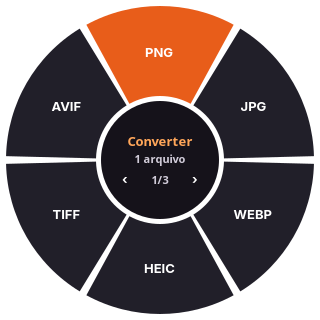
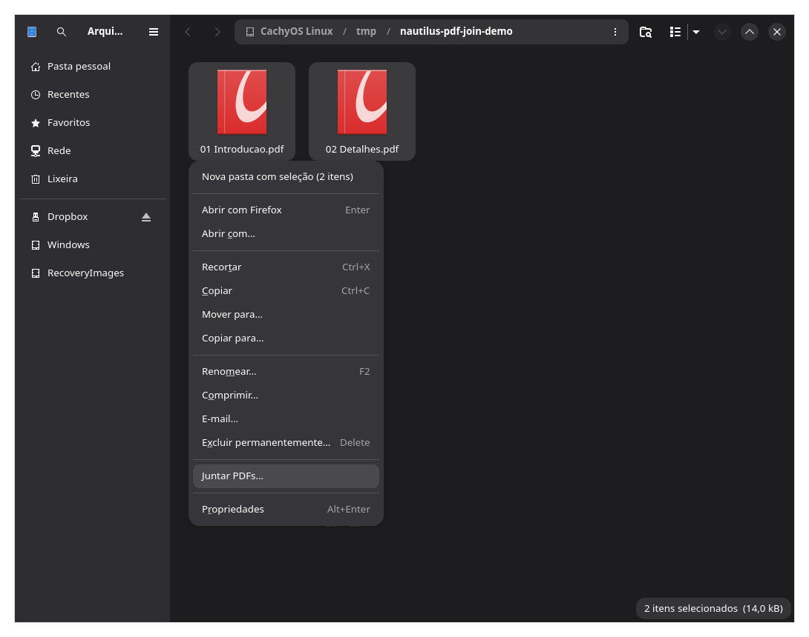
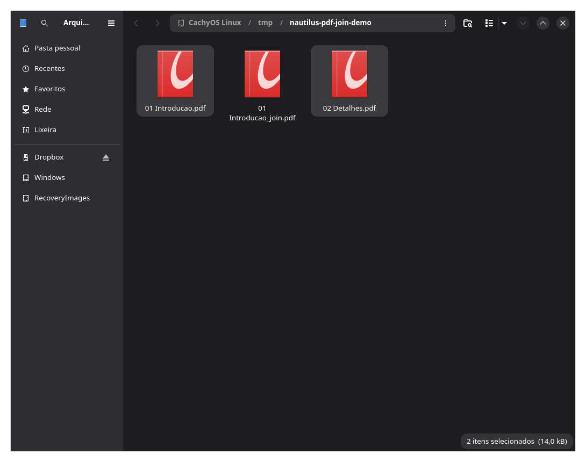

# Nautilus PDF Join

Junte dois ou mais PDFs pelo menu de botão direito do **Nautilus (Arquivos do GNOME)**. O resultado é criado automaticamente na pasta do primeiro PDF em ordem alfabética, com o final **`_join.pdf`**. Os arquivos originais são preservados.

## Círculo de conversão com Shift

Selecione um ou vários arquivos e **toque Shift e solte**, sem arrastar. Clique no formato desejado no círculo. Também é possível usar setas e Enter; Escape ou um clique fora fecham o círculo. Para vários PDFs, o círculo oferece **Juntar PDFs**, usando a mesma união e as mesmas regras do menu existente.

Shift+clique e Shift+setas continuam selecionando arquivos. O círculo não abre ao usar Shift combinado com outra tecla, durante cliques ou dentro de campos de texto. Funciona nas visualizações de grade e lista do Nautilus.

Quando há mais de seis destinos, use **‹ / › no centro do círculo**, a roda do mouse ou Page Up / Page Down para trocar de página. Todos os destinos continuam acessíveis sem sobrepor os nomes.



*Captura do componente GTK renderizado com arquivo sintético.*

| Seleção | Opções |
| --- | --- |
| Imagens | PNG, JPG, WebP, HEIC, TIFF, AVIF, BMP, GIF, ICO, JP2, JXL, QOI, TGA, PDF; SVG também é aceito como entrada |
| PDF | Texto, PNG, JPG, DOCX/ODT/RTF/Markdown/HTML/EPUB de texto; Juntar PDFs quando há vários |
| Áudio | MP3, M4A, WAV, FLAC, OGG, Opus, AIFF, WMA, AAC |
| Vídeo | MP4, MOV, MKV, WebM, AVI, WMV, GIF e extração para os formatos de áudio acima |
| Documentos e e-books | DOCX, ODT, DOC, RTF, Markdown, TXT, HTML, EPUB, reStructuredText, LaTeX, Org, FB2; PDF e imagens por página |
| Planilhas | XLSX, ODS, XLS, CSV, TSV, FODS, PDF, HTML e imagens por página |
| Apresentações | PPTX, PPT, ODP, PDF, PNG, JPG |
| Legendas | SRT, VTT, ASS, SSA, TXT |
| Compactados | ZIP, TAR, TAR.GZ, TAR.BZ2, TAR.XZ, 7Z; RAR também é aceito como entrada |

Foram executados e reabertos **345 pares distintos de entrada → saída** de imagens, áudio e vídeo, sem contar aliases nem conversões para o formato de origem. A verificação usa arquivos sintéticos pequenos; não é uma garantia para todo codec ou arquivo. Os resultados estão em [conversoes-verificadas.json](docs/conversoes-verificadas.json). Documentos, planilhas, slides, legendas e compactados têm verificações adicionais na suíte.

As opções dependem de ImageMagick, FFmpeg, Poppler, Pandoc, LibreOffice e libarchive (`bsdtar`). A disponibilidade dos codecs depende dessas ferramentas. O conversor não envia os arquivos para um serviço de conversão nem instala dependências automaticamente. Seleções de categorias diferentes não oferecem conversões. A extração de áudio exige que o vídeo contenha uma faixa de áudio.

Os resultados ficam ao lado de cada original. Nomes ocupados recebem `_2`, `_3` etc.; PDFs exportados como imagens geram um arquivo por página. Conversões de imagem preservam os quadros produzidos pelo ImageMagick; formatos como JPG geram arquivos separados quando há vários quadros. JPG usa fundo branco para transparência. A publicação das conversões é exclusiva e atômica no mesmo sistema de arquivos. Em lote, falhas são informadas e os resultados já concluídos são mantidos. Cada chamada ao conversor tem limite de três minutos.

Esta é uma implementação para Nautilus inspirada na interação do Tangerine, sem vínculo com o produto original. Não há OCR, exportação para Apple Pages, roda global fora do Nautilus ou ferramentas de recorte/edição. **PDF → DOCX e outros documentos extrai texto existente e não reconstrói o layout**; os destinos estão marcados com “texto” no círculo. Conversões entre formatos de documentos podem alterar formatação ou recursos específicos. PDFs escaneados precisam de OCR, não implementado. A exportação de planilhas para CSV/TSV cria um arquivo por aba, preservando as abas restantes como arquivos separados. O atalho acessa o modelo interno do Nautilus e pode precisar de adaptação após atualizações.



*Captura real da extensão em funcionamento no CachyOS, com Niri e Noctalia. Os documentos da imagem foram criados para demonstração.*

## Como funciona

1. Abra uma pasta no Nautilus.
2. Selecione **pelo menos dois arquivos PDF**.
3. Clique com o botão direito e escolha **Juntar PDFs…**.
4. Aguarde o arquivo com final `_join.pdf` aparecer na pasta.

Não há janela para escolher destino nem confirmação de sucesso. Uma janela de erro aparece se a operação falhar. A união ocorre em um processo separado, sem bloquear o gerenciador de arquivos.



### Nome e localização do resultado

Para esta seleção:

```text
01 Introducao.pdf
02 Detalhes.pdf
```

O resultado será:

```text
01 Introducao_join.pdf
```

Se esse nome já existir, a extensão procura o próximo disponível:

```text
01 Introducao_2_join.pdf
01 Introducao_3_join.pdf
```

O arquivo existente nunca é substituído. Se a seleção reunir arquivos de pastas diferentes, o resultado fica na pasta do primeiro PDF na ordenação usada pela extensão.

### Ordem das páginas

Os arquivos são ordenados pelo nome, sem distinguir maiúsculas e minúsculas; todas as páginas do primeiro vêm antes das páginas do segundo, e assim por diante. A ordem dos cliques e a ordenação visual da janela não controlam a união.

Para definir uma sequência, use prefixos como `01`, `02`, `03`. A ordenação é textual, não numérica: sem zeros à esquerda, `10.pdf` pode vir antes de `2.pdf`. Em nomes equivalentes, o caminho completo desempata a ordem.

### Quando a opção aparece

O menu é exibido somente quando:

- Há dois ou mais itens selecionados.
- Todos são reconhecidos pelo Nautilus como `application/pdf`.
- Nenhum item é uma pasta.
- Todos têm um caminho local acessível pelo sistema.

Selecionar um PDF junto com uma imagem ou uma pasta oculta a opção. Arquivos remotos sem caminho local, como URIs `smb://`, também não são aceitos. Um PDF de uma união anterior pode ser selecionado normalmente e terá suas páginas incluídas.

## Compatibilidade e dependências

A versão atual requer Linux, Nautilus com a API de extensões **4.1** e Python 3. A integração é com o Nautilus; Noctalia não é uma dependência.

| Componente | Para que serve | Versão verificada localmente |
| --- | --- | --- |
| Nautilus | Gerenciador de arquivos e menu de contexto | 51.1 |
| nautilus-python | Carregamento da extensão Python | 4.2.0 |
| Python | Execução da extensão e do processo de união | 3.14.8 |
| PyGObject | Acesso às APIs GObject/Nautilus | 3.58.1 |
| Poppler (`pdfunite`) | União dos PDFs | 26.08.0 |
| Zenity | Exibição de erros | 4.2.2 |
| Pycairo | Criação dos PDFs de teste; somente desenvolvimento | 1.29.2 |

Essas versões foram verificadas no CachyOS, em 19 de outubro de 2026. Outras distribuições e versões não foram testadas. O código exige explicitamente `Nautilus 4.1`; instalações que oferecem somente a API `4.0` precisam de adaptação antes de usar esta versão. Não há integração com Dolphin, Thunar ou Nemo.

## Instalação

### 1. Instale as dependências

No Arch Linux ou CachyOS:

```bash
sudo pacman -Syu --needed git nautilus nautilus-python python-gobject poppler zenity
```

O comando acima atualiza o sistema e instala os pacotes necessários. Em outras distribuições, os nomes dos pacotes podem ser diferentes; confirme também a disponibilidade da API Nautilus 4.1.

As dependências opcionais são `imagemagick`, `ffmpeg`, `libarchive`, `pandoc-cli` e `libreoffice-fresh` nos repositórios Arch/CachyOS. Sem uma ferramenta, as opções que precisam dela não aparecem. O conversor também procura executáveis em `~/.local/bin`, útil para instalações oficiais por usuário.

Nesta instalação, Pandoc 3.12.1 e LibreOffice 26.8.1 foram obtidos das distribuições oficiais, com SHA-256 conferido, em `~/.local/opt/` e links em `~/.local/bin/`. Os arquivos `SOURCE.txt` nessas pastas registram origem e checksum; atualizações dessas ferramentas são manuais. Nenhuma verificação de assinatura do gerenciador de pacotes foi desativada.

### 2. Baixe e instale a extensão para seu usuário

```bash
git clone https://github.com/pir0c0pter0/nautilus-pdf-join.git
cd nautilus-pdf-join
./install.sh
```

Execute `install.sh` como seu usuário normal, sem `sudo`. Ele verifica os executáveis obrigatórios e a disponibilidade das APIs Nautilus 4.1 e GTK4, depois copia `juntar_pdfs.py` e `conversor.py` para o diretório:

```text
~/.local/share/nautilus-python/extensions/
```

Se `XDG_DATA_HOME` estiver definido, o diretório será `$XDG_DATA_HOME/nautilus-python/extensions/`.

O instalador não instala pacotes do sistema e não reinicia o Nautilus. A verificação da API não substitui a instalação do carregador `nautilus-python`.

### 3. Reabra o Nautilus

Depois que todas as cópias ou movimentações de arquivos terminarem, encerre o Nautilus e abra-o novamente:

```bash
nautilus --quit
nautilus
```

Isso fecha as janelas do Nautilus. O carregamento de extensões no início do processo segue a [documentação oficial do nautilus-python](https://gnome.pages.gitlab.gnome.org/nautilus-python/nautilus-python-overview.html).

## Atualização

Dentro da pasta clonada:

```bash
git pull --ff-only
./install.sh
```

Reabra o Nautilus quando não houver operações de arquivos em andamento para garantir o carregamento da versão atualizada.

## Desinstalação

```bash
./uninstall.sh
```

Depois, reabra o Nautilus. O script remove os dois arquivos desta extensão no diretório de dados do usuário. Seus PDFs, outras extensões e os pacotes do sistema permanecem instalados.

## Segurança dos arquivos e limites

- Todo o processamento é local. A extensão não envia PDFs pela rede e não tem telemetria.
- Os caminhos são passados ao `pdfunite` como argumentos, sem executar nomes de arquivos em um shell. Espaços, acentos e caracteres especiais são preservados.
- A união é produzida primeiro em uma pasta temporária dentro da pasta de destino. Só após o sucesso do `pdfunite` o novo arquivo é criado, com abertura exclusiva para evitar sobrescrita.
- Falhas de conversão não deixam um PDF final. Falhas detectadas durante a cópia removem o resultado incompleto; uma interrupção abrupta do processo ou do sistema ainda pode deixar arquivos temporários ou parciais.
- É necessário espaço livre para o PDF temporário e para o resultado final simultaneamente. A pasta de destino precisa permitir gravação.
- Não há entrada de senha para PDFs protegidos. PDFs inválidos ou não aceitos pelo `pdfunite` produzem uma mensagem de erro.
- A extensão une documentos; não faz OCR, compressão, edição nem reordenação manual das páginas.
- Não há validação específica de assinaturas digitais, formulários, marcadores ou conformidade PDF/A no resultado. A validação automatizada cobre páginas e texto de PDFs simples.
- Não há barra de progresso nem botão de cancelamento. PDFs grandes podem levar mais tempo.

## Solução de problemas

### “Juntar PDFs” não aparece

Confira se todos os itens selecionados são PDFs locais e se há pelo menos dois. Depois, verifique a instalação:

```bash
test -f "${XDG_DATA_HOME:-$HOME/.local/share}/nautilus-python/extensions/juntar_pdfs.py" && echo "Extensão instalada"
python3 -c 'import gi; gi.require_version("Nautilus", "4.1"); from gi.repository import Nautilus; print("API disponível")'
```

No Arch/CachyOS, confirme também o carregador:

```bash
pacman -Q nautilus-python
```

Reabra o Nautilus após instalar a extensão ou o carregador. O menu não aparece em outros gerenciadores de arquivos.

### A operação mostra um erro

Confira os executáveis, o espaço livre e as permissões da pasta:

```bash
command -v python3 pdfunite zenity
```

A mensagem exibida inclui o erro de conversão quando o `pdfunite` rejeita um documento. Verifique se cada PDF abre normalmente e se exige senha.

### Preciso ver os erros do carregamento

Após encerrar as operações de arquivos, feche o Nautilus e abra-o em um terminal:

```bash
nautilus --quit
nautilus
```

Observe as mensagens no terminal. Ao abrir uma issue, informe sua distribuição, as versões do Nautilus e do Python, a mensagem de erro e passos para reproduzir. Use documentos de exemplo em vez de anexar arquivos pessoais.

## Desenvolvimento e testes

No Arch/CachyOS, adicione a dependência de testes:

```bash
sudo pacman -S --needed python-cairo
python3 -m unittest -v
```

A suíte gera PDFs temporários e testa o filtro do menu, a ordem das páginas, a preservação dos originais, os nomes automáticos, as colisões de nomes, os erros de PDF e a execução em outro processo. A instalação e a desinstalação são testadas em um `XDG_DATA_HOME` temporário, inclusive com espaços no caminho, sem modificar a instalação real.

Os testes não precisam abrir uma janela do Nautilus. O teste de ativação substitui o executável de diálogo por um auxiliar temporário e executa o processo de união real. O fluxo também foi verificado manualmente pelo menu, com PDFs de demonstração, para produzir as capturas acima.

- [Guia de desenvolvimento](docs/DEVELOPMENT.md): estrutura, decisões técnicas e validação.
- [Registro de continuidade](docs/CONTINUITY.md): estado do projeto, decisões da primeira sessão e próximos passos.
- [Histórico de versões](CHANGELOG.md).

## Licença

Código e documentação sob a [licença MIT](LICENSE). As capturas mostram a interface do Nautilus e documentos de demonstração; marcas e elementos de terceiros pertencem aos seus respectivos titulares. Este é um projeto independente, sem vínculo oficial com GNOME ou Noctalia.
